# Floor Plan Interior Designer · floorplan-3d-go

[中文](README.md) | English

[](https://github.com/wholeai/floorplan-3d-go/releases/latest)
[](LICENSE)
[](go.mod)

Design the interior of your own floor plan: **lay out furniture, remove walls and take measurements on a 2D plan, then switch to a 3D scene** — bird's-eye, first-person walkthrough, or standing inside a room at eye level like a showroom photo. Ten style packs with a one-click preview, a materials list derived from your actual geometry with a budget cap, cost per m², price tiers and overspend warning, plus plan-drawing PDF, quote sheet and Markdown brief exports. One small binary, no install, data kept in a local SQLite file.

> **Built on top of [wy51ai/floorplan-3d](https://github.com/wy51ai/floorplan-3d)** (MIT, 3.3k stars):
> this fork adds a Go + SQLite backend, vendors three.js locally (no CDN requests), supports sub-path
> deployment, and adds style packs plus a materials list. For the original pure front-end single-file
> `index.html` app, go straight to the upstream repository.

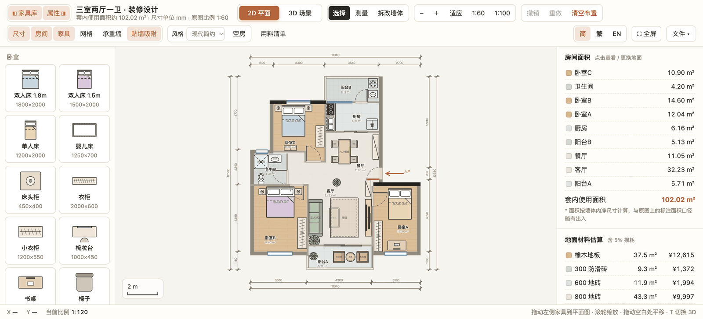

## Screenshots

| 2D plan with area estimates | 3D bird's-eye (Modern Minimal) |
| --- | --- |
|  | 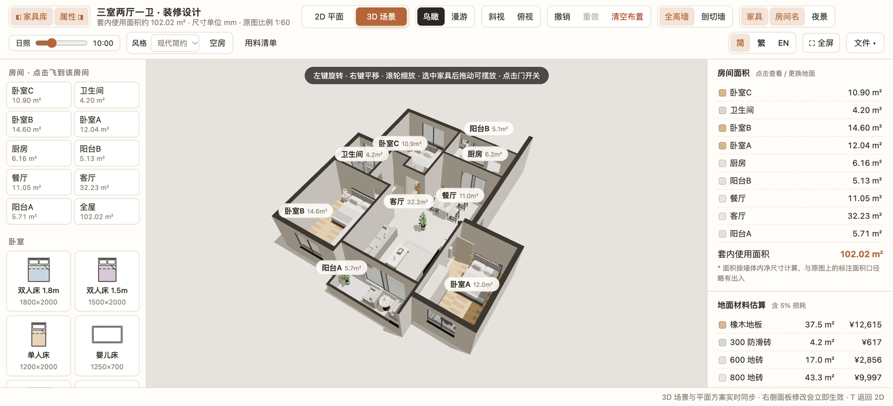 |

**One plan, one-click style packs** (a pack = flooring + wall/trim paint + furniture palette, undoable)

| New Chinese | Japandi |
| --- | --- |
| 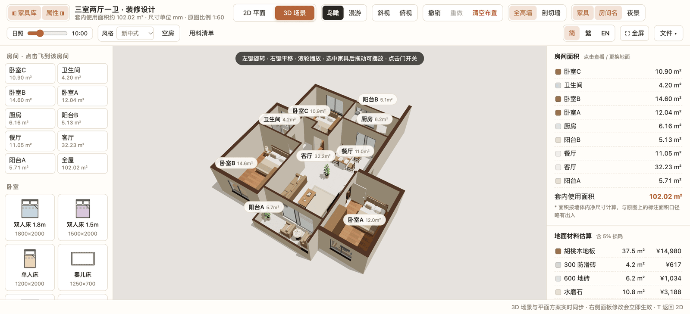 | 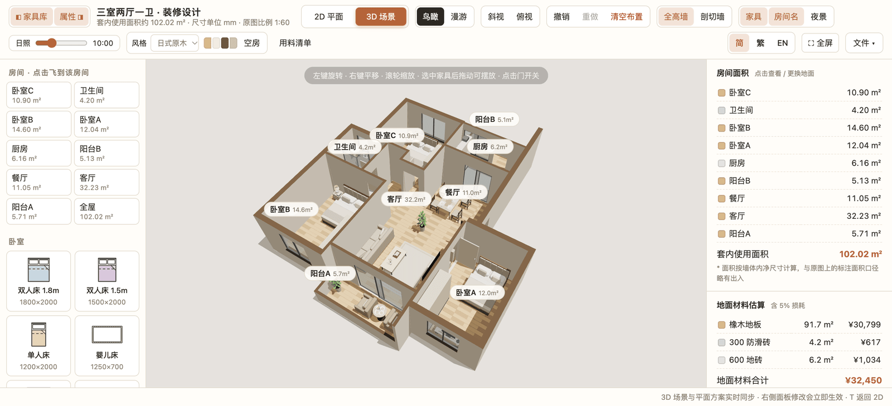 |

| Cream | Industrial |
| --- | --- |
| 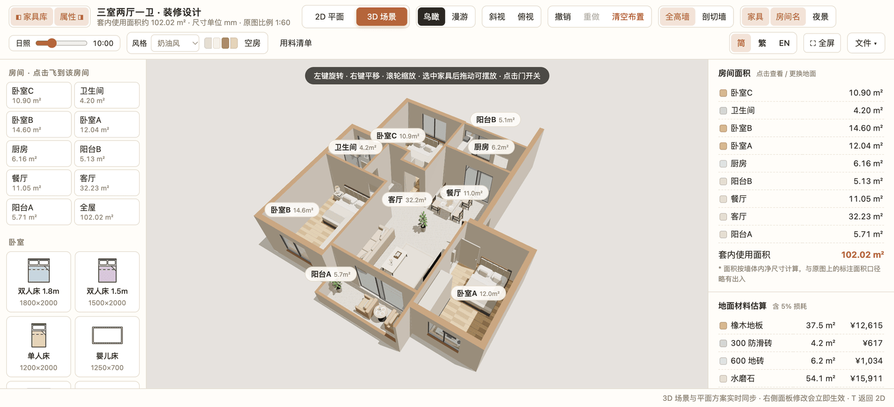 | 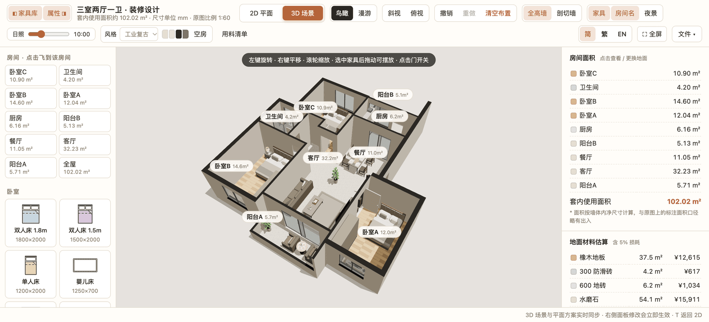 |

| Shell mode: bare structure only | Budget panel: cap, reserve, share by category |
| --- | --- |
| 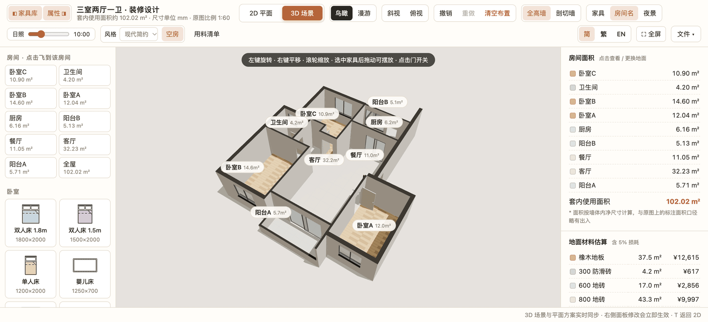 | 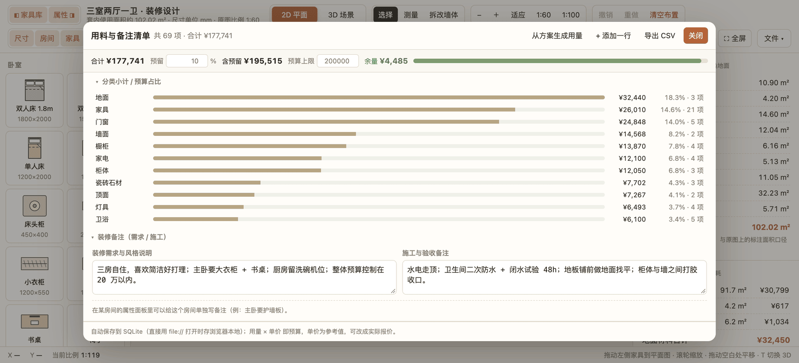 |

**Showroom: stand inside a room at eye level** (one click in the sidebar, full walls, 1.55 m eye height)

| Living room | Master bedroom |
| --- | --- |
| 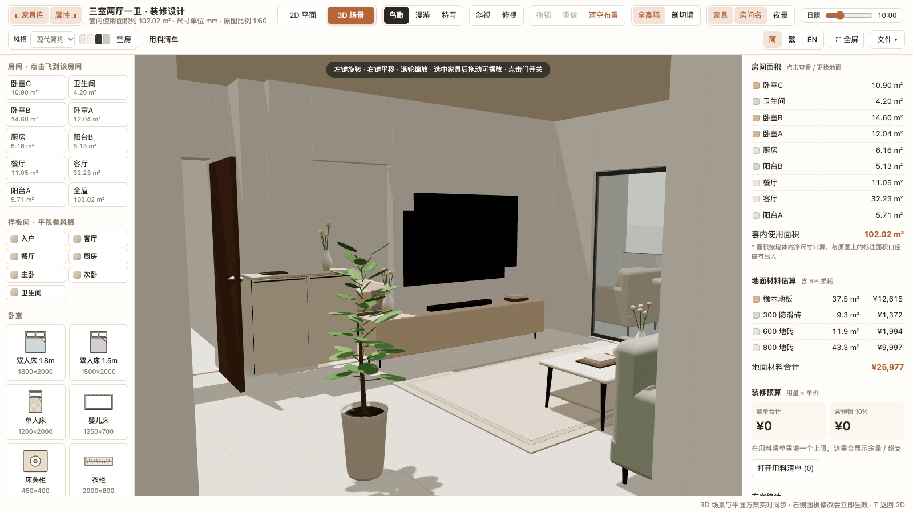 | 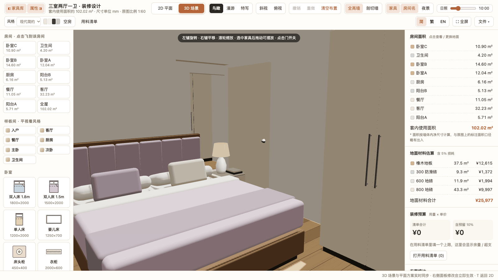 |

**Close-up: zoom into one room** (cut-away walls)

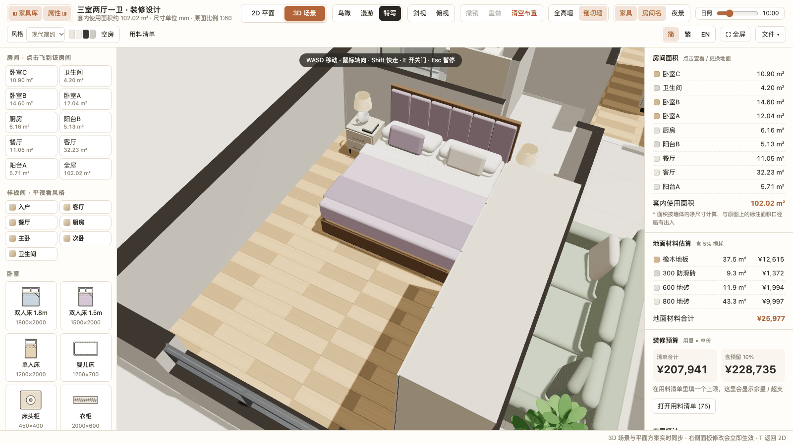

**Materials & notes list**: quantities derived from your plan, plus the budget, "already have" chips and price tiers

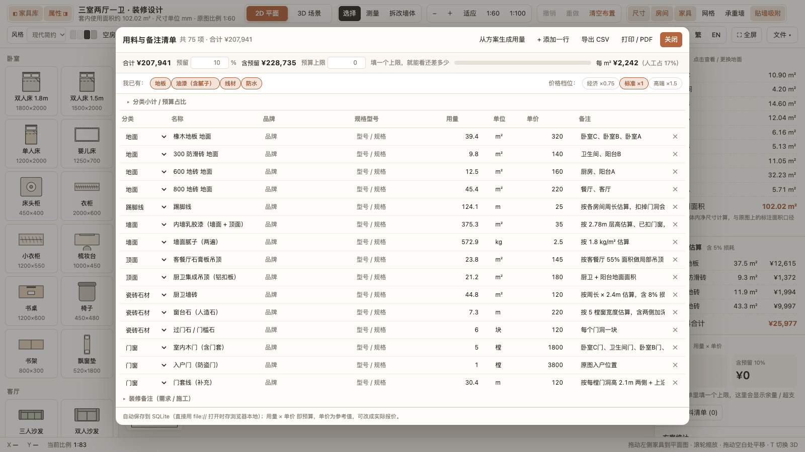

**Plan drawing (PDF)**: the plan plus room areas/flooring, changes/doors/windows and a material legend, ready for A4

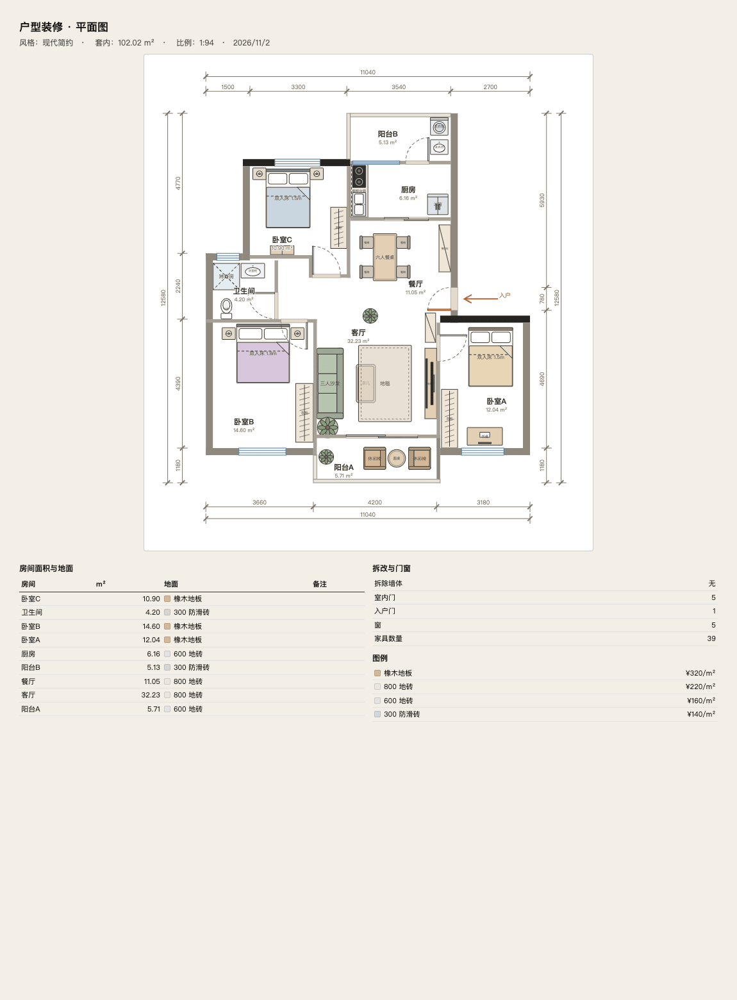

## Download and run

Grab the archive for your platform from [Releases](https://github.com/wholeai/floorplan-3d-go/releases/latest), unpack it and run `floorplan3d` (`floorplan3d.exe` on Windows). Your browser opens http://localhost:8787 automatically.

| Platform | File |
| --- | --- |
| Windows 10/11 x64 | `floorplan3d_1.5.0_windows_amd64.zip` |
| Windows 10/11 ARM64 | `floorplan3d_1.5.0_windows_arm64.zip` |
| macOS Apple Silicon (M-series) | `floorplan3d_1.5.0_darwin_arm64.zip` |
| macOS Intel | `floorplan3d_1.5.0_darwin_amd64.zip` |
| Linux x86-64 | `floorplan3d_1.5.0_linux_amd64.zip` |
| Linux ARM64 (Raspberry Pi etc.) | `floorplan3d_1.5.0_linux_arm64.zip` |

The binary is a static single file (~11 MB; `index.html` and three.js are embedded). No Go, Node or SQLite install required. Plans and the materials list live in `data/plan.db` next to the binary — copy that folder to move everything to another machine.

> macOS may block the first launch ("unverified developer"): right-click → Open, or run
> `xattr -d com.apple.quarantine floorplan3d`.
> On Linux / macOS you may need `chmod +x floorplan3d` first.

## Command-line flags

```bash
./floorplan3d                     # http://localhost:8787 and opens the browser
./floorplan3d -addr :9000         # different port
./floorplan3d -db ~/plan.db       # different database file (default data/plan.db)
./floorplan3d -base /floorplan    # serve under a sub-path: http://localhost:8787/floorplan/
./floorplan3d -no-open            # do not open a browser (servers / background)
./floorplan3d -version            # print version
```

## Run from source

```bash
git clone https://github.com/wholeai/floorplan-3d-go.git
cd floorplan-3d-go
go run .                    # requires Go 1.26+
```

No backend needed either: open `index.html` directly (or `python3 -m http.server 8000`) and the app skips `/api` and keeps everything in browser localStorage — same features, no database.

## Build & release

**Shipping a version is just a tag.** GitHub Actions cross-compiles all six platforms, zips them with `SHA256SUMS`, and creates the Release with the artifacts attached:

```bash
git tag -a v1.5.1 -m "v1.5.1: one line summary" && git push origin v1.5.1
```

The pipeline runs `gofmt → vet → go test → cross-compile → frontend syntax gate → ?selftest → e2e` and only publishes when all pass. To run it by hand: Actions → CI → Run workflow.

Local commands (offline use):

```bash
make            # current platform → dist/floorplan3d
make release    # all six platforms as zips + SHA256SUMS → dist/
make run        # go run .
make test       # Go unit tests (API + sub-path routing)
make check      # front-end syntax gate (no browser needed)
make e2e        # end-to-end: headless Chrome clicks real buttons (Node 22+)
make clean      # remove dist/
```

CI (`.github/workflows/ci.yml`): `push` to main and PRs run the tests; a `v*` tag additionally triggers the release job (`needs: [go, frontend]`), so a failing test can never publish a broken build.

The front-end quantity, budget and style-pack math has an assertion self-check: open `http://localhost:8787/?selftest=1`, results go to the console and to `window.__selftest` (65 assertions covering flooring area totals, door/window counts, labour rows, budget formulas, cost per m², price tiers, note persistence and the print sheet)

The end-to-end script `node scripts/e2e.mjs --url http://127.0.0.1:8787/` drives real clicks over CDP with 24 checks: generate the list → toggle "already have" and watch the budget → switch price tiers (including "hand-edited price is never overwritten") → overspend warning → print sheets → 3D entry and showroom viewpoints → new plan / isolation between plans / deletion → no JS exceptions..

Targets: `linux/{amd64,arm64}`, `darwin/{amd64,arm64}`, `windows/{amd64,arm64}`.

Cross-compiling works because the SQLite driver is a [pure-Go implementation](https://github.com/glebarez/go-sqlite) — no cgo, so `CGO_ENABLED=0` still produces static single files. The version is injected via `-ldflags "-X main.version=..."`; override with `make release VERSION=1.2.3`.

## Features

**2D floor plan**
- Displays the floor plan at 1:60 / 1:100 scale, dimensions in mm
- Drag 60+ furniture and appliance items from the library on the left (bedroom, living room, dining & kitchen, bathroom, appliances, study & leisure)
- Move, rotate (hold Shift for free angle), and resize items, with automatic snapping to walls
- Measuring tool (snaps to nearby walls; hold Shift to lock horizontal / vertical)
- Remove or modify non-load-bearing walls; load-bearing walls are marked separately
- Layer toggles: dimensions, room names, furniture, grid, load-bearing walls

**3D scene**
- Bird's-eye, oblique, and top-down views; click a room in the list to fly to it
- Walkthrough mode: WASD + mouse on desktop, virtual joystick on touch devices; click doors to open / close them
- Toggle between full-height and cut-away walls, time-of-day sunlight slider, night lighting
- Detailed furniture models: cabinet door gaps and handles, upholstered headboards, metal and ceramic materials with environment reflections, and more
- Select and drag furniture in 3D as well, kept in sync with the 2D plan in real time
- **Showroom viewpoints**: "Showroom · eye-level" in the sidebar drops you inside a room (entry / living / dining / kitchen / master / bedroom A / bath) at 1.55 m with full-height walls; the standing spot is sampled on a grid so it never lands in a wall or a wardrobe
- **Close-up (局部放大)**: switch the mode to "Close-up" and click a room to cut the walls and frame just that room; `?view=3d&closeup=bedB` opens it directly

**Style packs (10)**
- One dropdown in the top bar switches the whole scheme: Modern Minimal / New Chinese / Mediterranean / Nordic / Japandi / Cream / Modern Luxe / Industrial / French Classic / American Classic
- A pack = per-room flooring + 3D wall paint, trim and ceiling colour + furniture palette, applied as one undoable step
- The four-swatch strip next to the dropdown previews the current pack (floor / wall / trim / furniture); hover for material names and hex values
- "Shell" toggle hides every piece of furniture in 2D and 3D so you can look at the bare structure

**Materials list (quantities derived from your plan)**
- "BOM" button opens an editable table: category, item, brand, spec/model, qty, unit, unit price, notes
- "Fill from plan" derives **~75 rows across 16 categories** from the current plan (labour included):

  | Category | Examples | How it is derived |
  | --- | --- | --- |
  | Flooring | each floor material grouped by room | net room area × 1.05 waste; notes list the rooms |
  | Walls | interior paint, wall putty | each room's perimeter × 2.78 m ceiling, minus openings; putty at 1.8 kg/m² |
  | Ceilings | gypsum board (living/dining), aluminium panels (kitchen/bath) | 55% of living/dining area; kitchen/bath + balcony area |
  | Tiles & stone | kitchen/bath wall tiles, window sills, thresholds | wet perimeters × 2.4 m with 8% waste; window widths and door count |
  | Doors & windows | interior doors, entry door, casings, aluminium windows, insect screens | door count, window opening area (height derived from sill height) |
  | Hardware | lock sets, drawer slides, handles, floor drains | doors, cabinet count, bathrooms/balconies |
  | Lighting | main lights, downlights, LED strip, switches & sockets | main rooms, one per 6 m² of living/dining, half the perimeter, 4 per room |
  | Bath | toilet, shower set, vanity, heater, accessories | one set per bathroom |
  | Cabinets | base/wall units, quartz countertop, sink & tap | kitchen perimeter × 0.5 / 0.3 |
  | Soft furnishings | curtains (2× fullness), curtain track | total window width × 2 / × 1.15 |
  | Consumables | mortar, waterproofing, grout sealer, cable, PPR pipe, sealant | tiled area × 30 mm, wet areas + 30 cm upstand, 6 m cable per m², … |
  | Labour | plumbing & electrical, tiling, ceiling, painting, installation | estimated from areas / room count at reference rates; your contractor's quote wins |
  | Furniture / appliances / cabinets | counted by name with the rooms they sit in | items placed on the plan, with reference prices (toilets and countertops are not double-counted with the bath/cabinet rows) |

- Brand, spec, notes and price are yours to fill and **survive regeneration**; unit prices are references — replace them with your quotes
- The "brand" field suggests 50+ common brands (Shengxiang / Marco Polo / Nippon / Kohler / Oppein / Oriental Yuhong / Haier …) while still accepting free text
- **"Already have" chips**: flooring / paint (incl. putty) / cables / waterproofing — one click removes them from both the list and the budget (keyed by a stable id, so renaming a row cannot break it); click again to restore
- Editing a quantity or price updates the budget bar and category subtotals immediately
- Export to CSV (with BOM, opens directly in Excel)

**Budget**
- Total = Σ (qty × price); set a **budget cap** and the top progress bar shows the remaining amount or the overspend in red
- A **reserve percentage** (10% by default) is added to the total so "looks fine, bills over" is less likely
- "Subtotals by category" sorts categories by amount so you can see where the money goes (flooring / doors & windows / walls / cabinets…)
- **Cost per m²** and the **labour share** are shown right in the budget bar (and in the brief and the printed sheet): about ¥2,242/m² for the 102 m² sample
- **Price tiers**: budget ×0.75 / standard ×1 / premium ×1.5. Only rows still carrying a *reference* price are scaled — anything you typed yourself is flagged and never overwritten
- The side panel also shows a budget card: materials total / with reserve / cap / remaining

**Schedule estimate**
- Reference days per phase: demolition (by wall length), plumbing & electrical (by area), tiling (by tiled area), carpentry (by ceiling area), painting (by painted area), installation (by room count), plus a total in days/weeks
- Included in the Markdown brief and the printed quote — no Gantt chart, just enough to plan with a contractor

**Decoration notes**
- Every row has a free-form note (brand, workmanship, acceptance criteria)
- Two project-level notes at the bottom of the list: **requirements & style brief** and **site / workmanship notes**
- A note per room (open a room in the side panel), e.g. "headboard wall panelling", "leave space for a dishwasher"
- "File → Export brief (Markdown)" packs the style, areas, requirements, site notes, room notes, budget table and the full materials list into one `.md` you can send straight to a designer or contractor
- "Print / PDF" in the materials dialog renders a plain-text A4 landscape quote sheet (list + category subtotals + schedule + notes); input contents are never clipped. `?print=1` previews it on screen
- "File → Plan drawing (PDF)" outputs a drawing sheet: the current plan plus room areas/flooring, changes/doors/windows and a material legend, A4 portrait; `?print=plan` previews it

**Multiple plans side by side**
- "File ▾ → Plan" dropdown switches / creates / duplicates / renames / deletes plans; the top bar shows the active one
- Each plan is one row in SQLite and they never interfere: compare "wall removed + oak floor" against "no change + tiles"
- Deep link `?plan=<id>`; with `file://` it degrades to a single local plan

**Plans & statistics**
- Automatic calculation of room areas and net usable floor area
- Change the floor material of each room (wood, tiles, marble, terrazzo, carpet, etc.), with cost estimates based on area plus 5% wastage
- Undo / redo; the plan and materials list are saved to SQLite (`data/plan.db`), falling back to browser storage when opened as a `file://` page
- Chinese / English UI toggle (top-right button; defaults to Chinese and remembers your choice)
- Export to PNG, export / import plans as JSON (materials list included)

## Links & debug parameters

| URL | Effect |
| --- | --- |
| `?view=3d&show=living` | open 3D and stand in the living-room showroom viewpoint (`show=bedB` / `kitchen` / `__entry` …) |
| `?view=3d&closeup=bedB` | open the master-bedroom close-up (cut-away walls) |
| `?print=1` / `?print=plan` | print preview: quote sheet / plan drawing |
| `?selftest=1` | run the 66 front-end assertions; results go to the console and `#selftestResult` |
| `?plan=<id>` | open a specific plan |
| `?demo=1` | generate the materials list from the plan when it is empty (demo / screenshots) |
| `?bom=1` | open the materials dialog on load |
| `?still=1` | skip 3D camera animations (headless screenshots) |

## Keyboard shortcuts

| Key | Action |
| --- | --- |
| `T` | Toggle 2D / 3D |
| `V` / `M` / `X` | Select / Measure / Modify walls |
| `R` / `Shift+R` | Rotate selected furniture 90° clockwise / counterclockwise |
| `Delete` / `Backspace` | Delete selected furniture |
| `Ctrl/⌘ + D` | Duplicate selected furniture |
| `Ctrl/⌘ + Z`, `Ctrl/⌘ + Shift + Z` | Undo, redo |
| `F` | Fit to window |
| `+` / `-` | Zoom in / out |
| `[` / `]` | Show / hide the furniture library (left) and the side panel (right) |
| `Shift + F` | Fullscreen |
| `Esc` | Cancel current action |
| Walkthrough: `WASD` / arrow keys, `Shift`, `E` | Move, walk faster, open / close doors |

## Deploying under a sub-path (`https://www.test.com/floorplan`)

Every asset reference and API URL is relative, so both setups work.

**A. Let Go own the prefix**

```bash
./floorplan3d -addr 127.0.0.1:8801 -base /floorplan   # serve at /floorplan/ ; /floorplan 301s to /floorplan/
```

**B. Strip the prefix in a reverse proxy** (Nginx)

```nginx
location = /floorplan { return 301 /floorplan/; }   # without this, relative URLs resolve against the site root
location /floorplan/ {
    proxy_pass http://127.0.0.1:8801/;              # trailing / strips the /floorplan prefix
    proxy_set_header Host $host;
    proxy_set_header X-Forwarded-For $proxy_add_x_forwarded_for;
}
```

A complete site config (long-lived asset caching, PUT body limit) is in
[`deploy/nginx-floorplan.conf`](deploy/nginx-floorplan.conf). Run the backend on the loopback address
(`./floorplan3d -addr 127.0.0.1:8801 -no-open`) so only nginx can reach it.

> The URL **must end with a slash** (`/floorplan/`). At `/floorplan` the browser resolves relative paths
> against the site root, so every asset and `/api` call 404s — hence the 301s above.

## On a phone

The UI is responsive: on narrow screens dialogs switch to a single column, the budget bar wraps, and the furniture library / side panel collapse from the top bar. Open `http://<your-computer-ip>:8787` on the phone — the server listens on all interfaces and keeps using the same `data/plan.db`.

## Tech stack

- Vanilla HTML / CSS / JavaScript — no framework, no build step
- 2D floor plan rendered with SVG
- 3D scene built with [Three.js](https://threejs.org/) r160 (OrbitControls, PointerLockControls, RoundedBoxGeometry, RoomEnvironment, CSS2DRenderer)
- Backend: Go 1.26 `net/http` + SQLite (driver [`github.com/glebarez/go-sqlite`](https://github.com/glebarez/go-sqlite): pure Go, no cgo, no system SQLite)
- Zero external front-end dependencies: three.js and its five addons live in `static/three/`, wired up by `importmap` and embedded with `go:embed`
- Fully offline: the 3D scene loads with no network at all

### API

| Method | Path | Purpose |
| --- | --- | --- |
| `GET` / `PUT` | `/api/plan` | The default plan (same as `/api/plans/default`); kept for older scripts |
| `GET` / `POST` | `/api/plans` | Plan list; `POST ?from=<id>&id=<new>&name=<name>` duplicates one |
| `GET` / `PUT` / `DELETE` | `/api/plans/{id}` | Read / save (`?name=` renames) / delete a plan; `default` cannot be deleted |
| `GET` / `PUT` | `/api/items` | Materials list, saved by replacing the whole `items` table |

The front end debounces saves (500 ms / 400 ms), so dragging furniture does not flood the API.

### Schema

```sql
plans(id TEXT PRIMARY KEY, name TEXT, data TEXT, updated_at TEXT)   -- one row per plan
items(id INTEGER PRIMARY KEY AUTOINCREMENT, category, name, brand, spec,
      unit, qty REAL, price REAL, note, sort)
```

Plan ids allow letters, digits, `_` and `-`; `default` is the first plan (what `/api/plan` points at) and cannot be deleted.

`data/` is git-ignored; copy the directory to move your plan to another machine.

## Repository layout

```
index.html                  the entire front end (2D/3D/style packs/materials), no build step
main.go                     HTTP server + SQLite persistence + sub-path mounting
main_test.go                API and sub-path routing tests
Makefile                    cross-platform single-file builds / packaging
static/three/               vendored three.js r160 and addons
deploy/nginx-floorplan.conf example nginx reverse proxy for a sub-path
deploy/README-binary.txt    user notes shipped inside release archives
docs/screenshots/           README screenshots
```

## Customizing the floor plan

The floor plan data lives in `index.html`:

- `ROOMS`: room polygons, names, and default floor materials
- `WALLS` / `WINS`: walls and window openings
- `MATS`: floor material names and unit prices
- `LIB`: furniture library (type, name, default size, color)
- `STYLES`: style packs (flooring map, wall/ceiling paint, furniture palette)
- `buildFurniture()`: 3D models for each furniture type

Edit this data to use your own floor plan.

### Upgrading three.js

Replace the six files under `static/three/` (`three.module.js` plus the five addons under `addons/{controls,geometries,environments,renderers}`); the `importmap` at the top of `index.html` stays as is.

## Credits

- Upstream: [wy51ai/floorplan-3d](https://github.com/wy51ai/floorplan-3d) — the original 2D/3D floor-plan designer (MIT); the `index.html` front end here is derived from it
- [three.js](https://threejs.org/) r160 (MIT), vendored under `static/three/`
- [glebarez/go-sqlite](https://github.com/glebarez/go-sqlite) — pure-Go SQLite driver

Original author on X: [@akokoi1](https://x.com/akokoi1)

## License

[MIT](LICENSE) — same as upstream, original copyright notice (c) 2026 wuyi retained.
