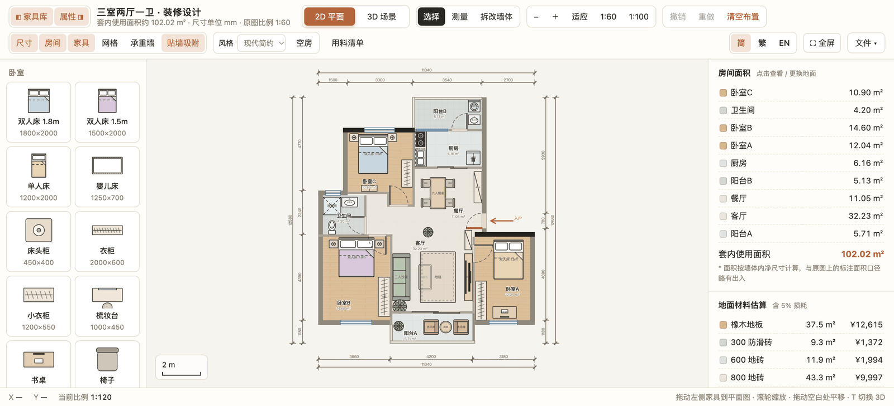
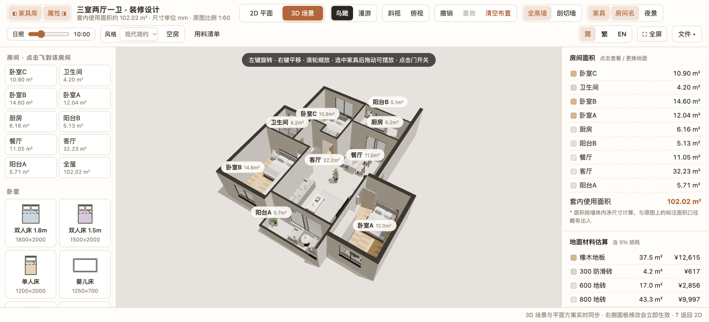
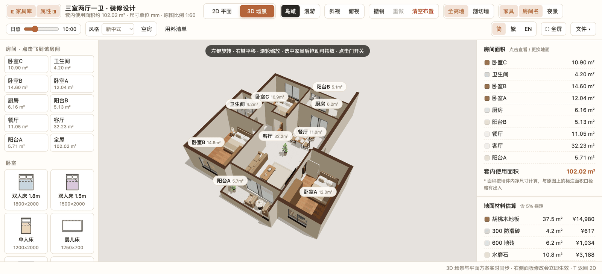
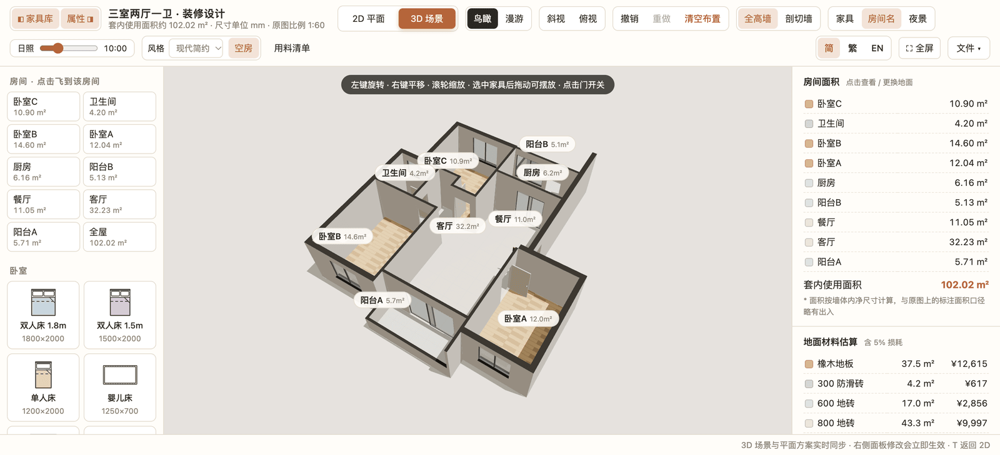

# 户型装修设计 · floorplan-3d-go

中文 | [English](README.en.md)

[](https://github.com/wholeai/floorplan-3d-go/releases/latest)
[](LICENSE)
[](go.mod)

在自己的户型图上做装修设计：**在 2D 平面图上摆家具、拆墙、量尺寸，一键切到 3D 鸟瞰或第一人称漫游**。单文件程序，下载即用，数据存在本地 SQLite 里。

> **本项目基于 [wy51ai/floorplan-3d](https://github.com/wy51ai/floorplan-3d)（MIT，3.3k stars）改造**：
> 换成 Go + SQLite 后端、把 three.js 全部本地化（不再请求 CDN）、支持子目录部署，并新增装修风格套装与用料清单。
> 想要原版纯前端单 `index.html`，直接访问上游仓库。



## 截图

| 2D 平面布置 + 面积估算 | 3D 鸟瞰（现代简约） |
| --- | --- |
|  |  |

| 3D 鸟瞰（新中式套装） | 空房模式：只看硬装毛坯 |
| --- | --- |
|  |  |

**用料与备注清单**（品牌 / 规格型号 / 用量 / 单价 / 备注，可导出 CSV）


## 下载即用

从 [Releases](https://github.com/wholeai/floorplan-3d-go/releases/latest) 下载对应平台的压缩包，解压后直接运行 `floorplan3d`（Windows 是 `floorplan3d.exe`），浏览器会自动打开 http://localhost:8787 。

| 平台 | 文件 |
| --- | --- |
| Windows 10/11 x64 | `floorplan3d_1.0.0_windows_amd64.zip` |
| Windows 10/11 ARM64 | `floorplan3d_1.0.0_windows_arm64.zip` |
| macOS Apple Silicon（M 系列） | `floorplan3d_1.0.0_darwin_arm64.zip` |
| macOS Intel | `floorplan3d_1.0.0_darwin_amd64.zip` |
| Linux x86-64 | `floorplan3d_1.0.0_linux_amd64.zip` |
| Linux ARM64（树莓派等） | `floorplan3d_1.0.0_linux_arm64.zip` |

程序是静态单文件（约 11 MB，`index.html` 与 three.js 全部内嵌），不需要安装 Go、Node 或 SQLite。方案与用料清单存在同目录的 `data/plan.db`，拷走这个目录就完成迁移。

> macOS 首次运行若提示"无法验证开发者"：右键 → 打开，或执行
> `xattr -d com.apple.quarantine floorplan3d`。
> Linux / macOS 首次执行前可能要给执行权限：`chmod +x floorplan3d`。

## 命令行参数

```bash
./floorplan3d                     # http://localhost:8787，并自动打开浏览器
./floorplan3d -addr :9000         # 换端口
./floorplan3d -db ~/plan.db       # 换数据库文件（默认 data/plan.db）
./floorplan3d -base /floorplan    # 挂在子路径：http://localhost:8787/floorplan/
./floorplan3d -no-open            # 不自动开浏览器（服务器 / 后台跑时用）
./floorplan3d -version            # 打印版本号
```

## 从源码运行

```bash
git clone https://github.com/wholeai/floorplan-3d-go.git
cd floorplan-3d-go
go run .                    # 需要 Go 1.26+
```

不想跑后端也行：直接用浏览器打开 `index.html`（或用 `python3 -m http.server 8000`），此时不连 `/api`，退化成浏览器 localStorage——功能一样，只是不落库。

## 构建

```bash
make            # 当前平台 → dist/floorplan3d
make release    # 六个平台全部打包（zip + SHA256SUMS）→ dist/
make run        # go run .
make test       # 单元测试
make clean      # 清掉 dist/
```

六个平台产物：`linux/{amd64,arm64}`、`darwin/{amd64,arm64}`、`windows/{amd64,arm64}`。

交叉编译之所以成立，是因为 SQLite 驱动是[纯 Go 实现](https://github.com/glebarez/go-sqlite)，不依赖 cgo，`CGO_ENABLED=0` 也能编出静态单文件。版本号通过 `-ldflags "-X main.version=..."` 注入，`make release VERSION=1.2.3` 可覆盖。

## 功能

**2D 平面布置**
- 按原始户型 1:60 / 1:100 比例显示，尺寸单位 mm
- 从左侧家具库拖入 60 余种家具家电（卧室、客厅、餐厨、卫浴、家电、书房休闲）
- 拖动移动、旋转（Shift 自由角度）、调整尺寸，贴墙自动吸附
- 测量工具（靠近墙面自动吸附，Shift 锁定水平 / 垂直）
- 拆改非承重墙，承重墙单独标示
- 图层开关：尺寸标注、房间名、家具、网格、承重墙

**3D 场景**
- 鸟瞰、斜视、俯视多种视角，点击房间列表可飞到对应房间
- 漫游模式：桌面端 WASD + 鼠标，触屏设备用虚拟摇杆，可以点门开关
- 全高墙 / 剖切墙切换，日照时间滑块，夜景灯光
- 精细家具模型：柜门分缝与拉手、软包床头、带环境反射的金属与陶瓷材质等
- 在 3D 中也能选中、拖动家具，与 2D 方案实时同步

**装修风格套装**
- 顶栏「风格」一键整套切换：现代简约 / 新中式 / 地中海 / 北欧
- 一套 = 各房间地面材质 + 3D 墙面漆色、墙顶饰面色 + 家具色板，一次切换即一步撤销
- 「空房」开关：2D / 3D 同时隐藏家具，只看硬装毛坯

**用料与备注清单**
- 顶栏「用料清单」打开表格：分类 / 名称 / 品牌 / 规格型号 / 用量 / 单位 / 单价 / 备注
- 「从方案生成用量」自动带出地面（按材质汇总含 5% 损耗）、内墙乳胶漆（按墙长 × 层高扣门窗）、踢脚线（按周长）、家具 / 家电 / 柜体（按名称计数并写明所在房间）
- 品牌、规格、备注、单价自己填，重新生成时这些字段会保留；可导出 CSV（带 BOM，Excel 直接打开）

**方案与统计**
- 房间面积与套内使用面积自动统计
- 为每个房间更换地面材料（木地板、地砖、大理石、水磨石、地毯等），按面积加 5% 损耗估算造价
- 撤销 / 重做；方案与用料清单自动存进 SQLite（`data/plan.db`），用 `file://` 打开时退回浏览器本地存储
- 中文 / English 界面切换（顶栏右侧按钮，默认中文，选择会记住）
- 导出 PNG 图片，导出 / 导入方案 JSON（含用料清单）

## 快捷键

| 按键 | 作用 |
| --- | --- |
| `T` | 切换 2D / 3D |
| `V` / `M` / `X` | 选择 / 测量 / 拆改墙体 |
| `R` / `Shift+R` | 选中家具顺时针 / 逆时针旋转 90° |
| `Delete` / `Backspace` | 删除选中家具 |
| `Ctrl/⌘ + D` | 复制选中家具 |
| `Ctrl/⌘ + Z`，`Ctrl/⌘ + Shift + Z` | 撤销，重做 |
| `F` | 适应窗口 |
| `+` / `-` | 放大 / 缩小 |
| `[` / `]` | 展开 / 收起左侧家具库、右侧面板 |
| `Shift + F` | 全屏 |
| `Esc` | 取消当前操作 |
| 漫游：`WASD` / 方向键，`Shift`，`E` | 移动，快走，开关门 |

## 部署到子目录（`https://www.test.com/floorplan`）

前端所有资源引用与接口地址都是相对路径，两种方式都支持。

**A. Go 自己带前缀**

```bash
./floorplan3d -addr 127.0.0.1:8801 -base /floorplan   # 访问 /floorplan/ ，/floorplan 会 301 到 /floorplan/
```

**B. 反向代理剥前缀**（Nginx）

```nginx
location = /floorplan { return 301 /floorplan/; }   # 少了这行，相对路径会以根目录为基准
location /floorplan/ {
    proxy_pass http://127.0.0.1:8801/;              # 结尾的 / 会剥掉 /floorplan 前缀
    proxy_set_header Host $host;
    proxy_set_header X-Forwarded-For $proxy_add_x_forwarded_for;
}
```

完整站点配置（含静态资源长缓存、PUT 请求体上限）见 [`deploy/nginx-floorplan.conf`](deploy/nginx-floorplan.conf)，
后端用 `./floorplan3d -addr 127.0.0.1:8801 -no-open` 起在回环地址上，只让 nginx 访问。

> 关键是**地址必须以 `/` 结尾**（`/floorplan/`）。`/floorplan` 后面没有斜杠时，浏览器会把相对路径解析到站点根目录，静态资源和 `/api` 全部 404，所以上面两处都做了 301。

## 技术栈

- 原生 HTML / CSS / JavaScript，无框架、无构建步骤
- 2D 平面图用 SVG 绘制
- 3D 场景用 [Three.js](https://threejs.org/) r160（OrbitControls、PointerLockControls、RoundedBoxGeometry、RoomEnvironment、CSS2DRenderer）
- 后端 Go 1.26 标准库 `net/http` + SQLite（驱动 [`github.com/glebarez/go-sqlite`](https://github.com/glebarez/go-sqlite)，纯 Go、无 cgo、无需系统安装 SQLite）
- 前端零外链：three.js 与 5 个 addons 放在 `static/three/`，由 `importmap` 指向本地，`go:embed` 打包进二进制
- 完全离线可用：断网也能打开 3D 场景

### 接口

| 方法 | 路径 | 说明 |
| --- | --- | --- |
| `GET` / `PUT` | `/api/plan` | 整个方案（房间地面、家具、拆墙、风格）的 JSON，单行 `plans` 表 |
| `GET` / `PUT` | `/api/items` | 用料清单，整表替换式保存到 `items` 表 |

前端保存是 500 ms / 400 ms 防抖的 PUT，拖动家具不会刷爆请求。

### 表结构

```sql
plans(id TEXT PRIMARY KEY, name TEXT, data TEXT, updated_at TEXT)
items(id INTEGER PRIMARY KEY AUTOINCREMENT, category, name, brand, spec,
      unit, qty REAL, price REAL, note, sort)
```

`data/` 已在 `.gitignore` 里，换机器把整个目录拷走即可。

## 目录结构

```
index.html                  整个前端（2D/3D/风格套装/用料清单），无构建步骤
main.go                     HTTP 服务 + SQLite 持久化 + 子路径挂载
main_test.go                接口与子路径路由测试
Makefile                    跨平台单文件构建 / 打包
static/three/               本地化的 three.js r160 与 addons
deploy/nginx-floorplan.conf nginx 子目录反代示例
deploy/README-binary.txt    打包进 release 的用户说明
docs/screenshots/           README 截图
```

## 自定义户型

户型数据写在 `index.html` 里：

- `ROOMS`：房间多边形、名称、默认地面材料
- `WALLS` / `WINS`：墙体与窗洞
- `MATS`：地面材料名称与单价
- `LIB`：家具库（类型、名称、默认尺寸、颜色）
- `STYLES`：装修风格套装（地面材质映射、墙 / 顶漆色、家具色板）
- `buildFurniture()`：各类家具的 3D 模型

改这些数据就能换成自己的户型。

### 升级 three.js

换版本只改 `static/three/` 下 6 个文件（`three.module.js` + `addons/{controls,geometries,environments,renderers}` 里用到的那 5 个），`index.html` 顶部的 `importmap` 不用动。

## 致谢

- 上游项目：[wy51ai/floorplan-3d](https://github.com/wy51ai/floorplan-3d) —— 2D / 3D 户型装修的原始实现（MIT），本项目的 `index.html` 前端由其改造而来
- [three.js](https://threejs.org/) r160（MIT），已本地化在 `static/three/`
- [glebarez/go-sqlite](https://github.com/glebarez/go-sqlite) —— 纯 Go 的 SQLite 驱动

原作者 X（Twitter）：[@akokoi1](https://x.com/akokoi1)

## 许可协议

[MIT](LICENSE) —— 与上游一致，保留原始版权声明 (c) 2026 wuyi。
